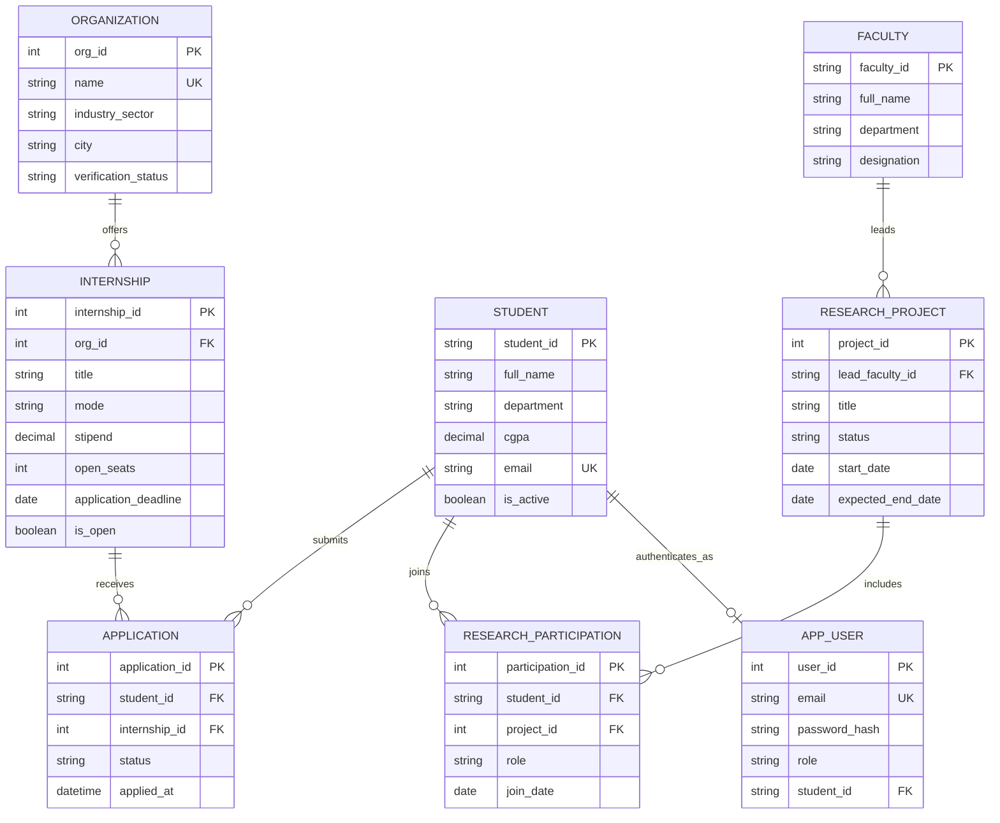

# ER diagram (Mermaid)

`APP_USER` is created by `server.js` at startup. `is_active` and `is_open` are added by `advanced_features.sql`, so apply `schema.sql` first and `advanced_features.sql` second.
