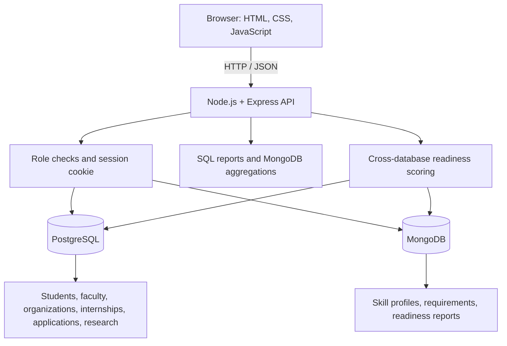

# Internship & Research Management System — Project Report Draft

## 1. Objective

Build a web-based system for managing student internship applications and faculty-supervised research participation. The application uses PostgreSQL for structured, relational records and MongoDB for flexible skill profiles, internship skill requirements, and generated readiness reports.

## 2. Functional requirements

- Display summary counts from PostgreSQL and MongoDB.
- Store student, faculty, organization, internship, application, research project, and participation records.
- Allow administrators to manage student and organization records, create internships, create research projects, assign participants, and update application statuses.
- Allow students to register against an existing student record, log in, apply to internships, manage their own skills, withdraw eligible applications, and view their own readiness analysis.
- Generate SQL reports and MongoDB aggregation reports.
- Compare internship skill requirements with student skills across the two databases and save explainable readiness results.
- Validate data using database constraints and triggers as well as API checks.

## 3. Architecture

## 4. Database selection and justification

**PostgreSQL** stores records with stable structure and relationships: primary keys, foreign keys, uniqueness, check constraints, joins, grouped reports, views, indexes, and triggers. Application status changes and seat-capacity rules are suitable for relational constraints and transactional updates.

**MongoDB** stores skill profiles, nested skill-level arrays, required skills for each internship, and computed skill-gap/readiness reports. These documents can contain variable-length arrays and are queried with aggregation pipelines.

The application links MongoDB documents to PostgreSQL records through matching `student_id` and `internship_id` values. These identifiers must remain consistent.

## 5. Relational schema summary

| Table | Purpose | Key relationships |
|---|---|---|
| `organization` | Organizations offering internships | One organization can offer many internships |
| `faculty` | Faculty supervisors | One faculty member can lead many research projects |
| `student` | Student profiles | Referenced by applications and research participation |
| `internship` | Internship listings and capacity/deadline | References `organization` |
| `application` | Student applications and workflow status | References `student` and `internship`; unique student/internship pair |
| `research_project` | Faculty-led projects | References `faculty` |
| `research_participation` | Student membership in projects | Junction between student and research project |
| `application_status_history` | Application status audit trail | Populated by triggers |
| `app_user` | Login identity, password hash, and role | Student role links to `student`; created automatically by the server |

## 6. MongoDB collections

- `internship_details`: one document per internship, including `internship_id` and `required_skills` array.
- `student_profiles`: one document per student, including `student_id` and `skills` array.
- `skill_gap_reports`: generated readiness report per student, including generation time and a per-internship breakdown.

## 7. Important database features

The SQL schema and advanced feature script define relational keys and constraints. Advanced SQL includes an application-status history table, triggers to block applications to closed internships or inactive students, validation of status transitions, automatic closure when selected candidates fill all seats, a summary view, a department selection-rate function, and indexes including full-text search.

The application also demonstrates SQL reports using joins, aggregates, grouping, and ordering, plus MongoDB aggregation pipelines for skill demand, campus demand versus supply, and common readiness gaps.

## 8. Novelty feature: explainable internship readiness

For each internship, the API compares required skills from MongoDB with a student's skill levels from MongoDB, while retrieving internship listings from PostgreSQL. Skill levels are mapped to numeric levels (Beginner=1, Intermediate=2, Advanced=3, Expert=4). Each skill receives a capped score of `min(student_level / required_level, 1)`. The readiness percentage is the mean of per-skill scores multiplied by 100. The response shows the required level, student's level, and whether the skill is Met, Partial, or Missing. Results are ranked and saved in `skill_gap_reports`.

**Project limitation:** the team should document a concrete campus problem that motivated this feature and any original improvement the team made. The handoff explicitly says an original novelty twist remains to be decided; do not claim one has been completed without team evidence.

## 9. Authentication and access control

The updated implementation provides Admin and Student roles. Student accounts can be created only when their email matches an active student record. Passwords are stored as salted scrypt hashes, not plaintext. Successful login issues an HTTP-only, same-site cookie. Admin-only routes protect administrative operations and reports; students can see their own applications, update their own skill profile, withdraw their own eligible applications, and access their own readiness results.

The initial admin account is bootstrapped from `ADMIN_EMAIL` and `ADMIN_PASSWORD` environment variables. The demo session store is in-memory and sessions are lost when the Node process restarts. For production deployment, use HTTPS, a persistent session store, CSRF protection, rate limiting, account recovery, and a formal security review.

## 10. Cross-database consistency

Creating an internship is a multi-database operation: the API begins a PostgreSQL transaction, inserts the internship, writes the matching MongoDB skill document, and commits PostgreSQL. If a later step fails, it rolls back PostgreSQL and attempts to remove the MongoDB document. PostgreSQL and MongoDB do not share a distributed transaction here, so the compensating action is best-effort rather than a strict atomic transaction across both engines.

## 11. Testing and evidence

Use `docs/TEST_CASES.md` as the acceptance test matrix. Execute each case on the target machine and record the real result and screenshot filename. Syntax checking is automated through `npm test`; database and browser tests must still be executed manually.

## 12. Known limitations / items requiring confirmation

- The original course brief says Next.js, but the current app uses a static HTML frontend served by Express. Ask the instructor whether that is acceptable before presenting.
- The MongoDB aggregations were marked unverified in the original handoff and must be tested locally.
- The team must add the ER diagram and data dictionary artefacts if they are not already available.
- The team must record actual member contributions in the README and commit each person's own changes from their own Git identity.
- The team must decide and validate an original novelty improvement based on a real user need.

## 13. Conclusion

The system demonstrates a combined relational and document-database workflow for internship and research management, advanced SQL rules and reports, MongoDB aggregation, role-based access, and an explainable cross-database readiness feature. The final submission should include executed test evidence, the required diagrams, accurate team contributions, and confirmation of the frontend framework requirement.
